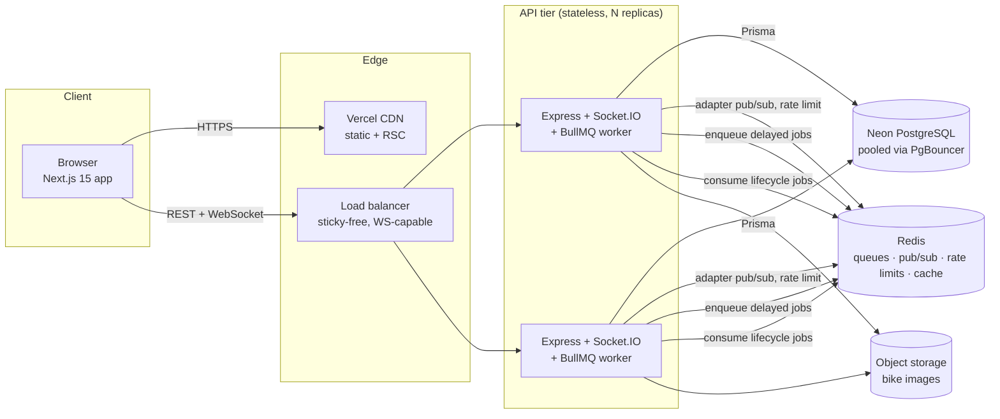
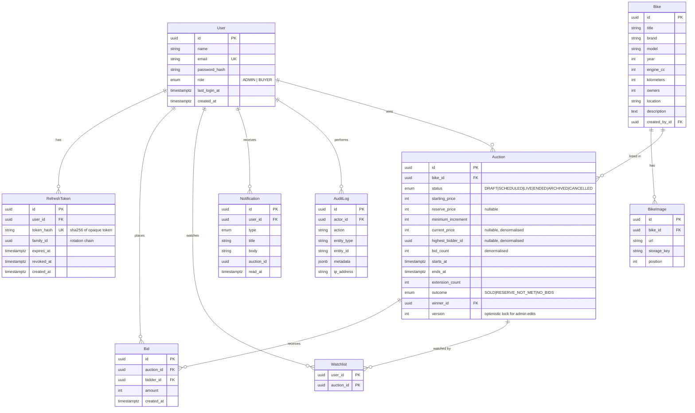
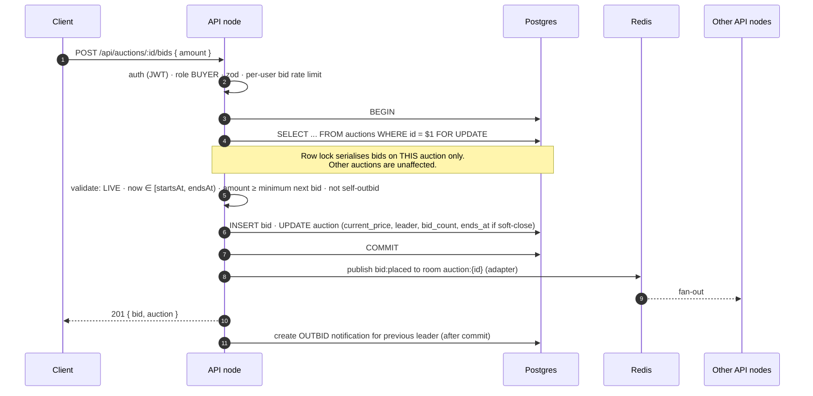
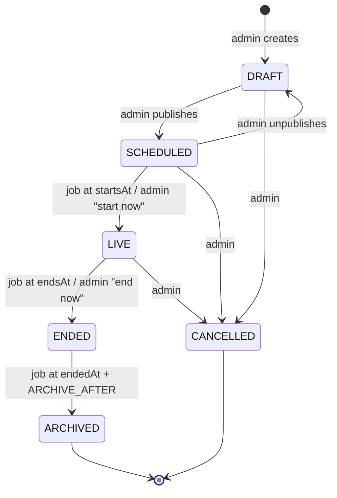

# AuctionRide — Architecture

This document describes how AuctionRide is built and, more importantly, *why* it is built that way.
It is the source of truth for system design decisions; the [README](../README.md) covers setup and usage.

---

## 1. Goals and non-goals

**Goals**

- Correctness of bidding under concurrency — two bidders must never both "win" the same price point.
- Real-time fan-out of auction state to every connected client within ~100 ms of a committed bid.
- Automatic, crash-safe auction lifecycle (start → end → winner → archive) with no hand-run crons.
- Horizontally scalable, stateless API nodes.
- Clear module boundaries so that features can be added without touching unrelated code.

**Non-goals (for v1)**

- Payments / escrow, KYC, shipping logistics.
- Proxy (automatic max) bidding — the domain model leaves room for it (see §12).
- Multi-currency. All amounts are whole Indian Rupees.

---

## 2. High-level architecture



Key properties:

- **API nodes hold no session state.** Access tokens are self-contained JWTs; refresh tokens live in Postgres;
  Socket.IO rooms are synchronised across nodes by the Redis adapter.
- **Lifecycle workers run inside the API process** (`RUN_WORKERS=true`), so there is a single deployable. BullMQ
  distributes jobs across every process that runs a worker, and jobs are idempotent, so running workers on several
  replicas is safe. Turning `RUN_WORKERS=false` on some replicas dedicates them to HTTP/WebSocket traffic.
- **Broadcasts from jobs reach every replica.** A worker emits through its own Socket.IO server, whose Redis adapter
  relays the event to the sockets connected to every other API node.

---

## 3. Backend architecture

### 3.1 Layering

```
HTTP request
   │
   ▼
routes/          — URL + method → middleware chain → controller. No logic.
   │
middlewares/     — auth, role guard, zod validation, rate limit, request id, error handling.
   │
controllers/     — translate HTTP ⇄ domain: read validated input, call one service method, shape response.
   │
services/        — business rules, transactions, authorization of *ownership*, emitting domain events.
   │
repositories/    — the only layer that imports Prisma. Query shapes live here.
   │
PostgreSQL
```

Rules enforced by convention and code review:

1. A layer only calls the layer directly beneath it.
2. Services receive their collaborators through constructors (manual dependency injection in `container.ts`).
   This keeps them unit-testable with plain fakes and avoids a DI framework.
3. Services throw typed `AppError` subclasses; only the error middleware turns them into HTTP responses.
4. Nothing outside `config/` reads `process.env`.

### 3.2 Folder structure

```text
backend/
├── prisma/
│   ├── schema.prisma
│   └── migrations/
├── src/
│   ├── app.ts                # express app factory (no listen) — used by server and tests
│   ├── server.ts             # HTTP + Socket.IO bootstrap, graceful shutdown
│   ├── container.ts          # composition root: wires repositories → services → controllers
│   ├── config/               # env parsing (zod), constants, cookie/cors config
│   ├── controllers/
│   ├── routes/
│   ├── services/
│   ├── repositories/
│   ├── middlewares/
│   ├── validators/           # zod schemas for body / params / query
│   ├── socket/               # Socket.IO server, auth handshake, room handlers, event publisher
│   ├── jobs/                 # BullMQ queues, schedulers, processors
│   ├── scripts/              # seed (compiled, so it also runs in the container)
│   ├── utils/                # errors, logger, response helpers, pagination, time
│   └── types/
└── tests/
    ├── unit/
    └── integration/
```

### 3.3 Request pipeline

`requestId → pino-http → helmet → cors → compression → json(limit 100kb) → cookieParser → global rate limit → routes → 404 → errorHandler`

- Every log line carries `reqId`, which is also returned as the `X-Request-Id` header and in error bodies,
  so a user-reported error can be traced in one search.
- Body size is capped; multipart uploads go through `multer` with per-file and per-request limits.

### 3.4 Response contract

Every JSON response uses one envelope so the client has one parser:

```jsonc
// success
{ "success": true, "data": { ... }, "meta": { "page": 1, "limit": 20, "total": 134, "totalPages": 7 } }

// error
{ "success": false, "error": { "code": "BID_TOO_LOW", "message": "Bid must be at least ₹1,05,000", "details": { ... }, "requestId": "..." } }
```

`code` is a stable machine-readable string; `message` is safe to show users; `details` carries zod issues for
validation errors. Stack traces are never serialised — they are logged server-side only.

---

## 4. Database schema

PostgreSQL (Neon) via Prisma. UUID primary keys, `timestamptz` everywhere (stored in UTC), snake_case table names.



### 4.1 Design decisions

| Decision | Rationale |
|---|---|
| Money stored as `INT` rupees | Avoids floating point and `Decimal` serialisation overhead. INT range (≈₹214 crore) far exceeds any motorcycle. Moving to paise is a mechanical migration if ever required. |
| `Bike` and `Auction` are separate | A bike that fails to meet reserve can be relisted as a new auction without rewriting history. Ended auctions are immutable. |
| Denormalised `current_price`, `highest_bidder_id`, `bid_count` on `Auction` | Listing pages read these for every card; computing `MAX(amount)` per auction per request does not scale. They are written in the **same transaction** as the bid insert, so they cannot drift. |
| `UNIQUE (auction_id, amount)` on `Bid` | A database-level guarantee of the invariant "bids strictly increase", independent of application code. |
| `BikeImage` table instead of `String[]` | Ordering, per-image deletion and storage-key tracking (for cleanup) need a row per image. |
| Refresh tokens stored as SHA-256 hashes | A database leak does not yield usable tokens. Tokens are 256-bit random, so a fast hash is sufficient (no bcrypt needed). |
| `family_id` on refresh tokens | Enables reuse detection: presenting an already-rotated token revokes the whole family (likely theft). |
| `AuditLog.metadata` is `jsonb` | Audit payloads vary per action; they are written often and read rarely. |

### 4.2 Indexes

| Table | Index | Serves |
|---|---|---|
| `auctions` | `(status, starts_at)` | upcoming list, scheduler reconciliation |
| `auctions` | `(status, ends_at)` | live list sorted by "ending soon", expiry reconciliation |
| `auctions` | `(winner_id)` | "won auctions" |
| `auctions` | `(bike_id)` | bike → auctions |
| `bids` | `(auction_id, amount)` unique | bid history (desc scan), invariant |
| `bids` | `(bidder_id, created_at)` | "my bids", won/lost computation |
| `notifications` | `(user_id, read_at, created_at)` | unread badge + feed |
| `refresh_tokens` | `(user_id)`, `(family_id)`, `token_hash` unique | rotation / revocation |
| `audit_logs` | `(entity_type, entity_id)`, `(actor_id)`, `(created_at)` | admin audit views |

---

## 5. Bidding — correctness under concurrency

Placing a bid is the hottest and most correctness-sensitive path in the system.



Why a pessimistic row lock rather than optimistic retries:

- Contention is inherently per-auction and short (the critical section is two small writes). A lock queue
  gives strictly ordered, fair processing; optimistic concurrency would turn a bidding war into a retry storm.
- The lock is scoped to a single row, so hundreds of simultaneous auctions proceed in parallel.
- `UNIQUE (auction_id, amount)` is a second line of defence.

**Minimum next bid** = `starting_price` if there are no bids, otherwise `current_price + minimum_increment`.

**Soft close (anti-sniping).** A bid accepted within the final `SOFT_CLOSE_WINDOW_SECONDS` (default 60s) extends
`ends_at` to `now + SOFT_CLOSE_EXTENSION_SECONDS` (default 60s), up to `MAX_EXTENSIONS`. This is standard on
serious auction platforms and prevents last-millisecond sniping. Clients receive the new `endsAt` in the same
`bid:placed` event.

**Time authority.** The server clock decides whether a bid is in time; `now()` is evaluated inside the
transaction. Clients only use time for display; each response carries `serverTime` so the UI can correct for
clock skew in its countdown.

---

## 6. Auction lifecycle



Transitions are implemented in one place, `AuctionLifecycleService`, guarded by an explicit transition table.
Any illegal transition raises `ConflictError(INVALID_STATE_TRANSITION)`.

**Winner determination (on `LIVE → ENDED`)**

| Condition | outcome | winner |
|---|---|---|
| no bids | `NO_BIDS` | — |
| `reserve_price` set and `current_price < reserve_price` | `RESERVE_NOT_MET` | — |
| otherwise | `SOLD` | highest bidder |

### 6.1 Scheduling with BullMQ

```mermaid
sequenceDiagram
  participant Admin
  participant API
  participant Q as BullMQ (Redis)
  participant W as Worker
  participant DB

  Admin->>API: publish auction (startsAt, endsAt)
  API->>DB: status = SCHEDULED
  API->>Q: add "start" job, delay = startsAt - now, jobId = start:{auctionId}
  Q-->>W: at startsAt
  W->>DB: lock row; if SCHEDULED and startsAt ≤ now → LIVE
  W->>Q: add "end" job, delay = endsAt - now
  Q-->>W: at endsAt
  W->>DB: lock row; if endsAt > now (soft-close extended) → re-enqueue; else → ENDED + winner
  W->>Q: add "archive" job
```

Design rules for jobs:

1. **Jobs are idempotent and self-validating.** A job carries only `auctionId`. The processor re-reads the auction
   under a row lock and acts only if the transition is still valid. Duplicate, late or stale jobs are no-ops.
2. **Deterministic job ids** (`start:{id}`, `end:{id}`, `archive:{id}`) mean rescheduling replaces rather than
   duplicates.
3. **A reconciliation sweep** runs as a BullMQ *repeatable* job every minute. It finds auctions whose
   `starts_at`/`ends_at` has passed without a transition (e.g. Redis was flushed, or a worker was down) and
   applies them. Delayed jobs give precision, while the sweep guarantees eventual correctness.
4. Retries use exponential backoff; exhausted jobs are kept for inspection (`removeOnFail: false` with a cap).

Redis for BullMQ must run with `maxmemory-policy noeviction`.

---

## 7. Real-time (Socket.IO)

### 7.1 Rooms

| Room | Joined by | Events |
|---|---|---|
| `auction:{id}` | anyone viewing an auction (anonymous allowed, read-only) | `bid:placed`, `auction:updated` |
| `auctions` | listing pages | `auction:updated` (status, price, endsAt) |
| `user:{id}` | each authenticated socket, automatically | `notification:new` |

### 7.2 Events (server → client)

```ts
'bid:placed'      { auctionId, bid: { id, amount, bidder: { id, displayName }, createdAt },
                    auction: { currentPrice, highestBidderId, bidCount, endsAt, minimumNextBid }, serverTime }
'auction:updated' { auctionId, status, currentPrice, bidCount, endsAt, outcome, winnerId, serverTime }
'notification:new' { id, type, title, body, auctionId, createdAt }
```

Client → server: `auction:join { auctionId }`, `auction:leave { auctionId }`, `auctions:subscribe`, `auctions:unsubscribe`.
Join payloads are validated with zod; a socket can be in at most `MAX_ROOMS_PER_SOCKET` auction rooms.

### 7.3 Why bids go over REST, not over the socket

- One code path for validation, auth, rate limiting, idempotency and error codes.
- An HTTP response is an unambiguous acknowledgement; socket acks are easy to lose on reconnect.
- Sockets stay a pure **fan-out** channel, which is the part that is expensive to scale and benefits from being simple.

### 7.4 Authentication

The client passes the access token in the handshake (`auth: { token }`). Invalid/expired tokens fall back to an
anonymous connection (they can still watch) rather than disconnecting; when the client refreshes its token it
reconnects. This keeps public auction pages live for logged-out visitors.

---

## 8. Authentication

```mermaid
sequenceDiagram
  participant C as Browser
  participant API
  participant DB

  C->>API: POST /api/auth/login {email, password}
  API->>DB: find user · bcrypt.compare (constant work even if user missing)
  API->>DB: insert refresh token (sha256 hash, new family)
  API-->>C: 200 { accessToken (15m JWT), user } + Set-Cookie: rt=…; HttpOnly; Secure; Path=/api/auth

  Note over C: access token kept in memory only (never localStorage)

  C->>API: GET /api/... Authorization: Bearer <access>
  API-->>C: 401 TOKEN_EXPIRED
  C->>API: POST /api/auth/refresh (cookie) + X-Requested-With
  API->>DB: lookup hash → valid? rotate: revoke old, insert new (same family)
  API-->>C: 200 { accessToken } + new cookie
  Note over API,DB: if a revoked token is presented → revoke entire family (reuse detection)
```

- **Access token:** HS256 JWT, 15 min, claims `{ sub, role }`, issuer/audience checked. Stored in memory only —
  immune to XSS persistence and never sent automatically by the browser (so not CSRF-able).
- **Refresh token:** opaque 256-bit random value, 7-day sliding expiry, `HttpOnly; Secure; SameSite` cookie scoped to
  `Path=/api/auth`. Rotated on every use with reuse detection.
- **CSRF:** the only cookie-authenticated endpoints are `/api/auth/refresh` and `/api/auth/logout`. They require a
  custom `X-Requested-With: XMLHttpRequest` header, which forces a CORS preflight that a cross-site attacker cannot
  pass because CORS allows only the configured frontend origin. `SameSite` is configurable: `lax` when the frontend
  and API share a site, `none` when they are on different sites (e.g. Vercel + Railway default domains).
- **Login hardening:** strict rate limit per IP + email, generic "invalid credentials" message, and bcrypt
  comparison against a dummy hash when the user does not exist, which prevents user enumeration via timing.
- **Authorization:** `requireAuth` verifies the JWT; `requireRole('ADMIN')` guards admin routes. Ownership checks
  (e.g. "my notifications") are done in services using the authenticated user id, never a client-provided id.
- **Frontend route protection** is a UX concern only (client guards in layouts); every authorization decision is
  re-made server-side.

---

## 9. API contract

All routes are prefixed with `/api` except health. `🔓` public · `👤` authenticated · `🛡` admin.

### Auth
| Method | Path | | Description |
|---|---|---|---|
| POST | `/auth/register` | 🔓 | Create buyer account, returns session |
| POST | `/auth/login` | 🔓 | Returns access token + sets refresh cookie |
| POST | `/auth/refresh` | 🍪 | Rotate refresh token, returns new access token + user |
| POST | `/auth/logout` | 🍪 | Revoke refresh token family, clear cookie |
| GET | `/auth/me` | 👤 | Current user |

### Auctions
| Method | Path | | Description |
|---|---|---|---|
| GET | `/auctions` | 🔓 | List. Query: `status`, `q`, `brand`, `minPrice`, `maxPrice`, `minYear`, `maxYear`, `sort`, `page`, `limit` |
| GET | `/auctions/brands` | 🔓 | Distinct brands for filter UI |
| GET | `/auctions/:id` | 🔓 | Detail incl. bike, images, `minimumNextBid`, `isWatching` (if authed), `serverTime` |
| POST | `/auctions` | 🛡 | Create (DRAFT) for a bike |
| PATCH | `/auctions/:id` | 🛡 | Edit DRAFT/SCHEDULED auction (optimistic `version`) |
| DELETE | `/auctions/:id` | 🛡 | Delete a DRAFT |
| POST | `/auctions/:id/publish` | 🛡 | DRAFT → SCHEDULED |
| POST | `/auctions/:id/unpublish` | 🛡 | SCHEDULED → DRAFT |
| POST | `/auctions/:id/start` | 🛡 | SCHEDULED → LIVE now |
| POST | `/auctions/:id/end` | 🛡 | LIVE → ENDED now |
| POST | `/auctions/:id/cancel` | 🛡 | → CANCELLED (with reason) |
| POST | `/auctions/:id/watch` | 👤 | Add to watchlist |
| DELETE | `/auctions/:id/watch` | 👤 | Remove from watchlist |

### Bids
| Method | Path | | Description |
|---|---|---|---|
| POST | `/auctions/:id/bids` | 👤 BUYER | Place bid `{ amount }` |
| GET | `/auctions/:id/bids` | 🔓 | Paginated history. Bidder names masked for non-admins |

### Bikes
| Method | Path | | Description |
|---|---|---|---|
| GET | `/bikes` | 🛡 | List / search |
| GET | `/bikes/:id` | 🛡 | Detail + auctions |
| POST | `/bikes` | 🛡 | Create |
| PATCH | `/bikes/:id` | 🛡 | Update |
| DELETE | `/bikes/:id` | 🛡 | Delete (only if never auctioned with bids) |
| POST | `/bikes/:id/images` | 🛡 | Multipart upload (`images[]`, ≤ 8 × 5 MB, jpeg/png/webp, magic-byte checked) |
| DELETE | `/bikes/:id/images/:imageId` | 🛡 | Remove image |

### Me (current user)
| Method | Path | | Description |
|---|---|---|---|
| PATCH | `/me` | 👤 | Update profile |
| GET | `/me/summary` | 👤 | Dashboard counters |
| GET | `/me/auctions?filter=` | 👤 | Auctions I bid on (`active`, `won`, `lost` or `all`), with my top bid and whether I lead |
| GET | `/me/watchlist` | 👤 | Watched auctions |
| GET | `/me/notifications` | 👤 | Paginated, `unreadOnly` filter |
| POST | `/me/notifications/:id/read` | 👤 | Mark read |
| POST | `/me/notifications/read-all` | 👤 | Mark all read |

### Admin
| Method | Path | | Description |
|---|---|---|---|
| GET | `/admin/dashboard` | 🛡 | KPIs, live auctions, recent bids |
| GET | `/admin/analytics` | 🛡 | Time series (bids/day, GMV/day), sell-through, top auctions |
| GET | `/admin/winners` | 🛡 | Ended auctions with winners |

### Health
| Method | Path | Description |
|---|---|---|
| GET | `/health` | `{ status, version, uptime, checks: { database, redis } }` — 503 if a dependency is down |
| GET | `/health/live` | Liveness (process up) — for orchestrator restarts |
| GET | `/health/ready` | Readiness (dependencies reachable) — for load balancer routing |

---

## 10. Frontend architecture

```text
frontend/
├── app/                    # routes only: layouts, pages, loading/error boundaries
│   ├── (marketing)/        # landing
│   ├── (auth)/             # login, register
│   ├── (app)/              # authenticated buyer area (dashboard, auctions, watchlist, won, profile)
│   ├── admin/              # admin area (role-guarded layout)
│   ├── not-found.tsx · error.tsx · global-error.tsx
├── components/
│   ├── ui/                 # shadcn/ui primitives (owned source, not a dependency)
│   └── shared/             # app-level composites: page header, empty state, countdown, price, etc.
├── features/               # vertical slices: auth, auctions, bids, bikes, admin, notifications, profile
│   └── <feature>/          # components/, hooks/, schemas.ts, api.ts
├── hooks/                  # cross-cutting hooks (debounce, media query, server time)
├── services/               # api client (fetch wrapper, refresh single-flight), socket client
├── store/                  # zustand: auth session, ui preferences
├── lib/                    # utils, formatters (INR), query keys, constants
├── providers/              # QueryClient, theme, socket, auth bootstrap
├── types/                  # API DTO types
└── styles/
```

**State ownership**

| Kind of state | Owner | Examples |
|---|---|---|
| Server state | TanStack Query | auctions, bids, notifications, analytics |
| Real-time deltas | Socket events written **into** the Query cache via `setQueryData` | new bid, status change |
| Session | Zustand `auth-store` | access token, current user, bootstrap status |
| UI preferences | Zustand `ui-store` (persisted) | sidebar collapsed, list view mode |
| Form state | React Hook Form + zod resolvers | login, bid, bike editor |
| URL state | search params | filters, pagination, tabs |

Sockets never own a separate copy of auction data. They patch the same cache that the REST queries fill, so
there is exactly one source of truth on the client, and a reconnect simply invalidates the affected queries.

**API client.** A thin `fetch` wrapper that attaches the in-memory access token, unwraps the response envelope into
typed data or a typed `ApiError`, and on `401 TOKEN_EXPIRED` performs a *single-flight* refresh (concurrent
requests wait on one refresh promise) before retrying once.

---

## 11. Deployment architecture

| Component | Target | Notes |
|---|---|---|
| Frontend | Vercel | `NEXT_PUBLIC_API_URL`, `NEXT_PUBLIC_SOCKET_URL` |
| API | Railway / Render (Docker) | ≥ 2 replicas, health check `/health/ready`, WebSockets enabled |
| Database | Neon Postgres | `DATABASE_URL` = pooled (PgBouncer) endpoint for the app; `DIRECT_URL` = direct endpoint for migrations |
| Redis | Redis Cloud | `noeviction` policy, TLS (`rediss://`) |
| Images | Local volume in dev; S3/R2 + CDN in production via `StorageProvider` | |

Migrations run as a release step (`prisma migrate deploy`) before new API instances receive traffic, never at
container start in a multi-replica deployment (the Docker entrypoint does it only when `RUN_MIGRATIONS=true`).

---

## 12. Scaling strategy (target: 100k users, thousands of concurrent bidders, hundreds of live auctions)

| Concern | Strategy |
|---|---|
| **API throughput** | Stateless Express nodes behind a load balancer; scale horizontally on CPU. JWT verification needs no DB call. |
| **WebSocket fan-out** | `@socket.io/redis-adapter` syncs rooms across nodes. Use WebSocket transport only in production to avoid needing sticky sessions for long-polling, or enable sticky sessions at the LB. For very large fan-out, move to the sharded Redis adapter (`SSUBSCRIBE`, Redis 7) so each auction room maps to a shard channel. |
| **Bid write contention** | Row lock per auction ⇒ contention scales with *bids per auction*, not total bids. A single hot auction handles hundreds of bids/sec on Postgres; beyond that, front it with a Redis Lua script as the sequencer and persist asynchronously (see trade-offs). |
| **Database** | Neon PgBouncer pooling (Prisma `connection_limit` tuned per replica). Read replicas for listing/analytics queries via a read-only Prisma client in repositories that are read-heavy. Partition `bids` by month if it grows beyond ~100M rows. |
| **Caching** | Listing pages tolerate ~2s staleness → Redis cache for `GET /auctions` first pages keyed by normalised query, invalidated on `auction:updated`. Admin analytics cached 60s. Bike images served from a CDN. |
| **Queues** | BullMQ workers run on any replica with `RUN_WORKERS=true`; concurrency per worker is configurable. Lifecycle jobs are tiny, so one worker handles thousands per minute. For isolation, a dedicated worker deployment can publish via `@socket.io/redis-emitter` (future work). |
| **Rate limiting** | Redis-backed store so limits are global across replicas, not per node. |
| **Frontend** | Static/ISR marketing pages on Vercel's CDN, route-level code splitting, `next/image` lazy loading. |
| **Observability** | Structured JSON logs (pino) → any log pipeline. A `/metrics` endpoint with `prom-client` slots into the existing middleware chain (request duration histogram, bid latency, queue depth, socket count). |

---

## 13. Security considerations

- **Transport:** HTTPS only in production; `Secure` cookies; HSTS via Helmet.
- **Headers:** Helmet defaults (CSP for the API is `default-src 'none'` since it serves JSON), `X-Content-Type-Options`, frameguard.
- **CORS:** explicit origin allowlist from `CORS_ORIGINS`; credentials enabled only for those origins.
- **Input:** every body, param and query parsed by zod with `.strict()` objects — unknown keys are rejected, not ignored.
- **SQL injection:** Prisma parameterises all queries; the single raw query (`FOR UPDATE`) uses tagged-template parameters.
- **XSS:** React escapes output; no `dangerouslySetInnerHTML`; user text is length-capped; uploaded files are re-validated by magic bytes and served with `X-Content-Type-Options: nosniff`.
- **Uploads:** randomised file names (no user-controlled paths), mime + magic-byte allowlist, size limits.
- **Secrets:** only via environment; `config/env.ts` fails fast at boot if any are missing or weak (e.g. JWT secret < 32 chars).
- **Abuse:** global rate limit, stricter limits on auth and bidding; account self-outbid prevention; bid amount upper bound.
- **Auditability:** every admin mutation and auth event is written to `audit_logs` with actor, IP and user agent.
- **Least privilege:** public endpoints mask bidder identities (`R***l`); full identities are admin-only.

---

## 14. Trade-offs

| Choice | Benefit | Cost / when to revisit |
|---|---|---|
| Postgres row lock as the bid sequencer | Strong consistency, simple, auditable | Single-auction throughput bounded by one row lock (~hundreds/sec). Revisit for "flash" auctions with tens of thousands of bidders. |
| REST for bids, sockets for fan-out | One validation path, clear acks | One extra round trip vs. socket emit (negligible). |
| Workers in the API process | One deployable, no extra socket bridge | A slow job shares CPU with HTTP traffic; split into a dedicated worker deployment if job volume grows. |
| Access token in memory | Not readable after XSS-induced reload, not CSRF-able | Every full page load does one refresh call. |
| Client-side route guards | Works with a cross-origin API and in-memory tokens | Protected page shells are rendered before the session is known (a skeleton is shown; no data leaks since data comes from the API). |
| Integer rupees | Simplicity | No paise; acceptable for vehicle auctions. |
| Local disk storage behind an interface | Zero-config development | Not suitable for multi-replica production — swap in the S3 provider. |
| Manual DI over a container library | Explicit, no magic, trivially testable | Slight boilerplate in `container.ts`. |

---

## 15. Assumptions

- Currency is INR; amounts are whole rupees.
- One winner per auction; the winner is the highest bidder if the reserve (if any) is met.
- Auctions cannot be reopened once ENDED or CANCELLED; relisting creates a new auction for the same bike.
- A bike can have at most one non-terminal auction (DRAFT / SCHEDULED / LIVE) at a time.
- Reserve price is optional and never revealed to buyers — only whether it has been met.
- Admins cannot bid. Buyers cannot outbid themselves.
- All timestamps are stored and transmitted in UTC (ISO-8601); the UI renders in the viewer's local time zone.
- Images are stored on local disk in development; production should use object storage.
- Registration always creates `BUYER` accounts; admins are provisioned via seed/CLI.
